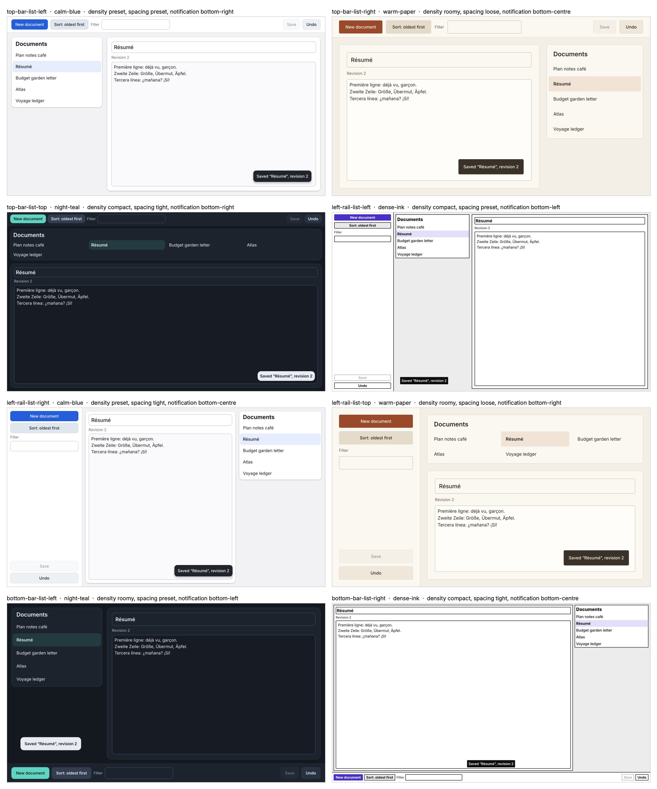

# Hand-off: issue #8, layout families, validators and the stress-test set

Written 2026-11-26 by the session that implemented issue #8, on branch `claude/issue-8-layout-families-6a509e`. Nothing was pushed, no pull request was opened and nothing was merged.

The full account is the issue 8 section of [records/milestones/S2.md](../../records/milestones/S2.md). This note is what to look at first.

## See it



`families.png` is one application state in each of the eight layout families, at 1120 by 630, the visual presets taken in turn. It was drawn for this note by a throwaway script and is not evidence; the evidence is the dataset and its tests.

```bash
uv run core-ultra data generate --config configs/data/families-v1.json
```

writes 358 records and their images to `artifacts/datasets/families-v1/` (about eight seconds, 28 MB, git-ignored), and the 20 stress tests with their pictures to `artifacts/datasets/families-v1/stress/`.

## What landing it changes for you

- **`artifacts/datasets/tiny-v1/` on this Mac was written by generator version 1.** `data check` on that folder will now report every record as different, because a record lists six validators where it listed two. The model inputs and targets are identical, hash for hash, and the committed tiny manifest was not rewritten. To have a tiny dataset that passes `data check`, generate it into another folder with `--out`.
- **Issue #32's branch touches the same three documents** (`README.md`, `records/milestones/S2.md`, `docs/roadmap.md`). My edits there are in my own sections, except the roadmap's status line and issue count and the first sentence of the S2 record, which both branches will have changed.

## Decisions I made that you may want to overrule

Each is recorded with its reason under "Decisions" in the S2 record. The ones closest to design:

1. **The eight families.** Which 8 of the 243 combinations are sampled is a preference, declared in `configs/layout/v2.json`. Roomy never goes with tight, compact never with loose.
2. **The notification only sits along the lower edge.** Along the top it covered the title field, and the validators rejected it.
3. **Density is 0.85, 1 and 1.15 on heights; spacing is 0.75, 1 and 1.25 on distances.** Type size does not change with density.
4. **The rail's width** is the widest filter field plus a margin either side. No token was added to DESIGN.md.
5. **A coverage gap is reported and does not fail the command.**

None of these blocks issue #9. The pilot gallery is where they are best judged.

## Review

Two sub-agents reviewed the first commit, one against the repository's standards and one against the issue. They found that two validators were enforcing taste (padding around text, and one container for each part of the workspace). Both rules were removed in the second commit. The S2 record lists everything the review found and what was done about each.
