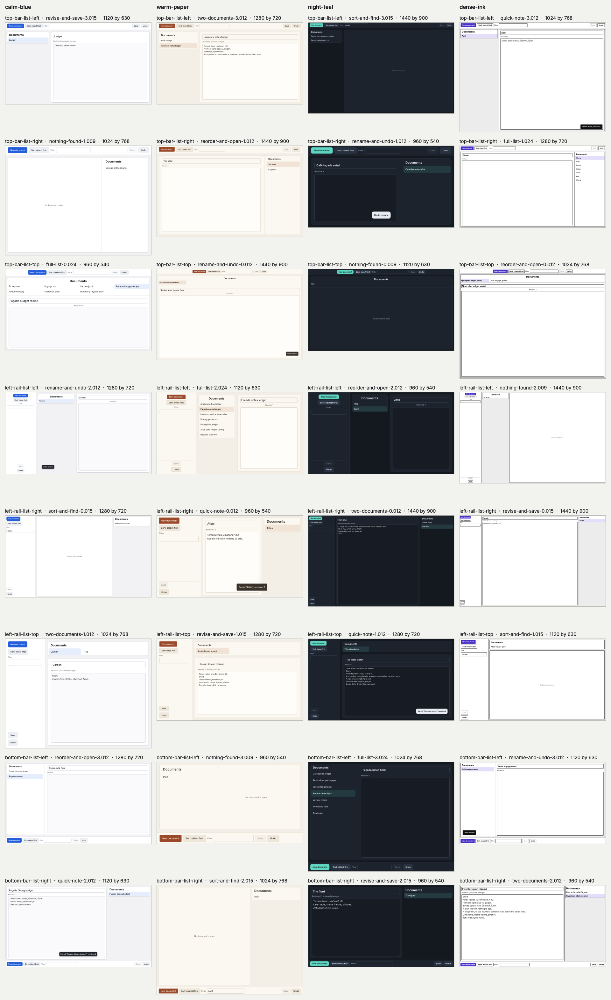

# Hand-off: the pilot gallery, for your go (issue #10)

Written 2026-11-26 by the session that implemented issue #9, on branch `issue-9-pilot-gallery`. The full account is the issue 9 section of [records/milestones/S2.md](../../records/milestones/S2.md). This note is what to open and what to look for.

## Open it

The gallery is a folder on this Mac, built from the pilot dataset. It is git-ignored, like the dataset; its manifest is committed.

```bash
open artifacts/galleries/pilot-v1/index.html
```

If the folder is not there (another checkout, or after a clean), these two commands make it again, byte for byte, in about twelve seconds:

```bash
uv run core-ultra data generate --config configs/data/pilot-v1.json
```

```bash
uv run core-ultra data gallery artifacts/datasets/pilot-v1
```

The page opens from disk and loads nothing from a network. Nothing was installed, and nothing records what you do in it.

## What is in it

- **476 dataset records** from 32 scripted sessions, each as its reference image, drawn in A, Reference by the runtime renderer.
- **Every layout family in every visual preset**: 8 families by 4 presets is 32 pairs, and each pair is one session.
- **Each picture is labelled** with its layout family, visual preset, design condition and state.
- **A coverage summary** at the top, by layout family, visual preset, density, content length, element state and viewport size. No declared value is without a record.
- **Shown apart, at the end**: the two viewport sizes a session was refused, each drawn with its reason, and the stress-test set of 20, labelled as never a training target. No state of the pilot itself was rejected.

Three filters at the top narrow the page by layout family, visual preset and element state. A picture opens larger when you choose it; the left and right arrow keys move through the pictures and Escape closes it.

## See it without opening it



`pairs.png` is the last state of each of the 32 sessions, the eight layout families down and the four visual presets across. It was drawn for this note by a throwaway script from the pilot's own images and is not evidence; the evidence is the dataset, the gallery and their tests. The pictures have different shapes because the sessions have different viewport sizes.

## What your go decides

Issue #10 asks one thing: do these look coherent enough to scale? A go lets issue #11 freeze the split rules and generate the full dataset. Anything that does not look coherent becomes its own ticket blocking #10.

The questions earlier records left for this gallery:

1. **Does each visual preset read as intentional**, and does each of the 32 pairs? Any family may meet any preset: `dense-ink` meets compact, `warm-paper` meets roomy and loose.
2. **Compact changes heights and not type.** `dense-ink` at compact has buttons 22 units high around 12 unit type. Filter to `dense-ink` and look at `top-bar-list-top`, `left-rail-list-left` and `bottom-bar-list-right`.
3. **A centred heading stands over rows whose text starts at the left** (`top-bar-list-top`, `left-rail-list-left`). Alignment moves boxes, never the text inside one; changing that is a change to the scene schema.
4. **The two groups of `tasks` are seen only by the divider between them** (`left-rail-list-left`, `left-rail-list-right`, `bottom-bar-list-right`).
5. **Field borders are faint in `calm-blue`**, at about 1.9 to 1.
6. **A rail leaves empty room** between its upper and lower buttons in a tall viewport (the `left-rail` families at 1440 by 900). This one is mine, from the sheet above; no record raised it.

## Measured, to size the full dataset

`measure generation` on the pilot, three runs on this Mac: 10.5 s for the pilot, 22.1 ms an example; 33.1 MiB on disk, 68.9 KiB an example; peak memory 159 MiB. Multiplied out, and not measured: 20,000 examples would be about 7.4 minutes and 1.31 GiB. Neither time nor disk limits the full dataset's size. The record is `records/measurements/generation/20261126T222414Z-pilot-v1-6b5d299af418.json`.

## Decisions I made that you may want to overrule

Each is recorded with its reason under "Decisions" in the S2 record.

1. **Every pair once, with short scenarios.** 32 sessions stay under 500 records only with three to eight actions each. The cost: 28 of the 32 sessions never have more than three documents, and the seven-document list is in four of the eight families (`top-bar-list-top`, `top-bar-list-right`, `left-rail-list-left`, `bottom-bar-list-left`).
2. **State, in a label and in the summary, is element state**: what is pointed at and how, then every state the frame shows.
3. **The gallery is a folder with a page and its pictures**, not one file. The page with its pictures inside would be 21 MB.
4. **A rejected state is drawn again by the gallery** from the dataset's configuration. The generator and every committed manifest are unchanged.
5. **A title can repeat within one list** (`full-list-1` has the same one three times). That is issue 7's content, left as it is.
