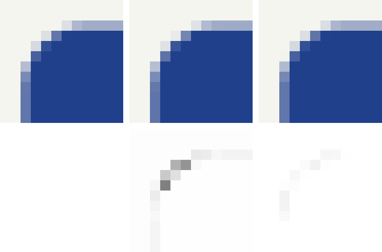

# Hand-off: training renderer stage 1 (issue #12)

Written 2026-11-27 by the session that implemented issue #12, on branch `issue-12-training-renderer-stage-1`. The full account is the issue 12 section of [records/milestones/S3.md](../../records/milestones/S3.md). This note is what was built, what it found, and the one thing that is yours.

## What was built

A second renderer, in PyTorch, that draws a scene's rounded rectangles as an image a network can learn through. And a command that proves its learning signal is right:

```bash
uv run core-ultra renderer check
```

It takes about seven seconds, installs nothing and records nothing about you. It writes one record with the support matrix. The committed one is `records/renderer/20261127T100441Z-stage-1-6b5d299af418.json`.

| It draws | Its learning signal reaches | Checked |
| --- | --- | --- |
| Rounded rectangles with fill and opacity | Position, size, corner radius, fill, opacity | All seven, on the CPU against a slow independent calculation, and on the Mac's GPU against the CPU |
| Not yet: borders, text (#13), shadows (#14) | | |

The Mac's GPU ran all of it with nothing unsupported and nothing falling back to the CPU.

## What it found: the app's own renderer draws rounded corners slightly off

This is the one thing that is yours, and it is [issue #37](https://github.com/robdhyman/core-ultra-neural-engine/issues/37).

To check the new renderer I measured both renderers against a third, slow, exact count of how much of each pixel a shape covers. On square corners all three agree to rounding. On rounded corners the new renderer is close, and the runtime renderer, the one that draws every reference image, is off by up to 31 levels of 255 on a few pixels of each corner.



Top row, left to right: exact, the runtime renderer, the training renderer. Bottom row: where the runtime renderer and the training renderer each differ from exact, darker for more. In this corner the runtime renderer is 21 levels off at worst and the training renderer 2. The picture was drawn for this note by a throwaway script and is not evidence; the evidence is the record's `agreement` section.

What I do not know: the cause. The error changes with the radius and the scale in no order, which is what a curve drawn as a few straight pieces would give, but I read and changed nothing in Qt.

What it costs: nothing in training, because the picture-based loss compares the new renderer with itself. To the eye it is a slightly lumpy corner at some sizes; nobody has looked at it enlarged in a real scene.

What a fix costs: every reference image changes, and so does every image hash in every committed dataset and gallery manifest, the pilot's included. That is why it is not fixed here, and why it is cheapest to decide before the full dataset (#11).

## Three things issue #18 should expect

These are how the new renderer truly behaves. Each is tested and is in the record under `limits`.

1. **It refines, it does not find.** An element learns its position only from pixels its own outline crosses. One that does not touch its target is not pulled toward it. The structure loss has to place elements; the picture-based loss can only sharpen them.
2. **A corner radius that goes past half the shorter side stops learning.** It is drawn as a pill and gets no signal to come back. The network's output for it must be kept inside the bound.
3. **The picture-based loss can lower itself by making an element disappear.** With colour and opacity free, an element that half overlapped its target faded to nothing. That is the loss and not the renderer.

## Decisions I made that you may want to overrule

Each is recorded with its reason under "Decisions" in the S3 record.

1. **A shape's edge is exact, not blurred.** Square-cornered elements come out as the runtime renderer's own pixels. The price is item 1 above. A blurred edge would pull from further away and would no longer match.
2. **A rounded corner is drawn as its tangent line.** Close for corners of two pixels' radius and more, up to 17 levels too full on its own few pixels below that.
3. **The check uses its own small scenes, not dataset records**, because dataset records have borders, text and shadows, which this stage does not draw.
4. **I moved the code that reads what PyTorch says about the Mac's GPU into one file** that `measure step` now shares. Its record and its tests are unchanged.
