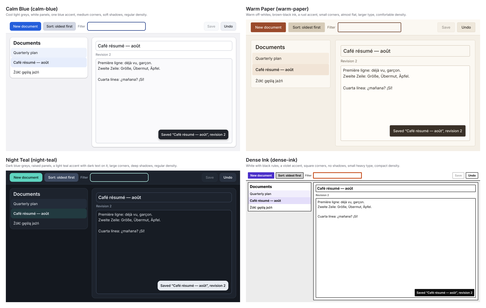
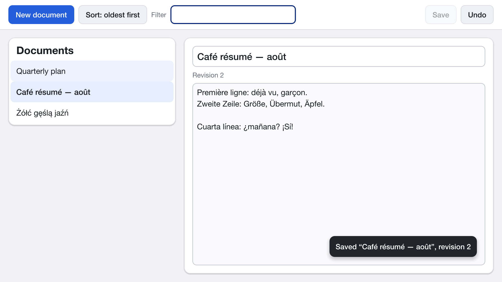

# Core Ultra neural engine

A pre-alpha in which a trained scene model writes an interface as a scene that deterministic code draws. The spec is [issue 1](https://github.com/robdhyman/core-ultra-neural-engine/issues/1); vocabulary is in [GLOSSARY.md](GLOSSARY.md).

Tested platform: macOS 27 on an Apple M5 with 16 GB of memory. No cross-platform claim is made, and the dependency lock is resolved for macOS on Apple silicon only.

## Set up

The environment is Python 3.12, managed and locked with [`uv`](https://docs.astral.sh/uv/). Nobody chooses a version: `.python-version` pins the interpreter and `uv.lock` pins every package.

```bash
uv sync --locked
```

## Command line

There is one entry point, `core-ultra` (also `python -m core_ultra`). Its verbs so far are `doctor`, `measure step`, `design check`, `design draw`, `data generate` and `data check`.

`scene export` and `scene compare` are described under [Scene export](#scene-export).

### `doctor`

```bash
uv run core-ultra doctor
```

`doctor` reports the OS version, Python version, accelerators, memory, free disk and every declared dependency with its version and whether it imports. The Apple GPU path counts as usable only when a small forward and backward pass runs on it in 32-bit floats and agrees with the CPU. It exits 1 when the report lists a problem.

| Flag | Effect |
| --- | --- |
| `--json` | Print the report as JSON instead of text. |
| `--save` | Also write the report to `records/doctor/<time>-<environment id>.json`. |
| `--save PATH` | Also write the report to `PATH`. An existing file is never overwritten. |

A saved record is what later measurements point at. `--save` prints the record's path, its SHA-256 and the report's `environment_id`, a hash of the fields that identify the environment (project version, OS build, hardware, Python, memory size, accelerators and dependency versions). Time, free memory and free disk are left out of that hash, so two runs on an unchanged machine share one id.

The report holds no host name, user name, serial number or absolute path, because records are committed to a public repository.

### `measure step`

```bash
uv run core-ultra measure step
```

`measure step` times a complete training step (zeroing gradients, forward, loss, backward, optimiser update) and reads its peak memory, for a placeholder scene model at every size, batch size and device in a configuration. It takes several minutes. Run it on AC power with Low Power Mode off and other applications closed: each case records free memory, swap in use, the power source and Low Power Mode, and the record says so when a case ran throttled. It exits 1 when doctor lists a problem or another measurement is already running (nothing is measured), or when no starting size could be chosen.

The placeholder ([src/core_ultra/placeholder.py](src/core_ultra/placeholder.py)) is a transformer encoder with the planned output positions (32 bound, 16 structural) and output fields. Its inputs and targets are random numbers, so the measurement says what a step costs and nothing about what a model learns.

| Flag | Effect |
| --- | --- |
| `--config PATH` | Measurement configuration. Default: `configs/measure/training-step-v1.json`. |
| `--records DIR` | Folder the records are written under. Default: `records`. |
| `--json` | Print the measurement record as JSON instead of text. |

Every run saves two records, neither ever overwritten: a doctor record in `records/doctor/` and the measurement in `records/measurements/training-step/`. The measurement names the doctor record with its SHA-256, and every case carries the doctor report's `environment_id`.

What the record holds:

- **Step time.** Every timed step of every case, with median, mean, minimum, maximum and 90th percentile. On the Apple GPU path the clock stops only after the device has finished its queued work. A separate set of steps, never counted in the step time, splits forward, loss, backward and update.
- **Peak memory.** Each case runs in its own process. The figure is the peak of the process's physical footprint as macOS accounts it, which on Apple silicon includes memory held for the GPU.
- **Apple GPU path.** Timed cases run with PyTorch's CPU fallback switched off, so an operation the path does not implement stops the step and is named. One further untimed run per size allows the fallback and turns on PyTorch's MPS profiler, which logs each CPU fallback and counts copies between CPU and GPU memory.
- **Starting size.** Chosen by the rule in the configuration: among sizes that ran on the Apple GPU path with no CPU fallback, inside the memory budget and the time budget, the one inside the planned parameter range nearest its middle. If memory or time rules out the whole range, the record names that limit.
- **Projections.** Run durations computed as steps multiplied by the measured median step, labelled as projections. The epoch counts in them are assumptions for scale. The record lists what the step does not include (the render loss, the assignment inside the structure loss, data loading, evaluation).

The chosen size is recorded in `configs/scene-model/v1.json`, which names the measurement record it came from with its SHA-256.

### `design check`

```bash
uv run core-ultra design check
```

`design check` compares [DESIGN.md](DESIGN.md) with the generator configuration, `configs/design/v1.json`: every token of every visual preset, every component, the states and the font family. It exits 1 and lists each disagreement by name when the two differ, when DESIGN.md breaks the format rules this project relies on, or when the configuration cannot be used. The tests run the same check, so a change to one file without the other fails `uv run pytest`.

| Flag | Effect |
| --- | --- |
| `--design-md PATH` | The written design. Default: `DESIGN.md`. |
| `--config PATH` | The generator configuration. Default: `configs/design/v1.json`. |

### `design draw`

```bash
uv run core-ultra design draw
```

`design draw` draws one application state in A, Reference in every visual preset and writes one PNG per preset, a sheet of all of them and a manifest with the SHA-256 of each image, each scene, the configuration and the font. It exits 2, writing nothing, when a file exists with other contents.

| Flag | Effect |
| --- | --- |
| `--out DIR` | Folder the images are written to. Default: `records/design/v1`. |
| `--scale N` | Pixels per viewport unit. Default: 2. |

### `data generate`

```bash
uv run core-ultra data generate --config configs/data/tiny-v1.json
```

`data generate` runs the scripted sessions of a dataset configuration against the application kernel. For every state a session reaches, the reference layout engine writes the true scene, the runtime renderer draws it, and one dataset record and one reference image are written. A manifest of hashes is written last. The same configuration always gives the same bytes. A state whose true scene fails scene validation is not written; the manifest lists it under `rejected` with every reason.

It exits 2, writing nothing, when the configuration cannot be used or the folder already holds a different dataset. A dataset is never overwritten.

| Flag | Effect |
| --- | --- |
| `--config PATH` | The dataset configuration. Required. |
| `--out DIR` | Folder the dataset is written to. Default: `artifacts/datasets/<name>-v<version>`. |

### `data check`

```bash
uv run core-ultra data check artifacts/datasets/tiny-v1
```

`data check` checks a written dataset. Every file must have the hash the manifest gives. No record's model inputs may hold the target, an image or diagnostic metadata. Every target must be a valid scene that carries the application's bound elements unchanged. Generating the dataset again from its own `config.json` must give the same bytes. It exits 1 and lists every problem by record.

## Design source

The design is original and is held twice. [DESIGN.md](DESIGN.md) is the written one, in the Google Labs DESIGN.md format (version alpha): tokens as YAML, then prose. `configs/design/v1.json` is the generator configuration, the machine-readable one the reference layout reads. `design check` keeps them the same.

Both cover semantic colours, typography, spacing, dimensions, borders, radii, elevation, density, the styling of each element and the five states (default, hover, pressed, focused, disabled). The format has no place for some of that, so DESIGN.md uses extension keys, which the format allows; its Overview lists them. Google's own linter for the format is not run by this project.

There are four visual presets. Each is a complete set of values for the same tokens, so a preset changes how every element looks and never what an element says or does.

| Preset | Character |
| --- | --- |
| `calm-blue` (default) | Cool light greys, white panels, one blue accent, medium corners, soft shadows, regular density. |
| `warm-paper` | Warm off-whites, brown-black ink, a rust accent, small corners, almost flat, larger type, comfortable density. |
| `night-teal` | Dark blue-greys, raised panels, a light teal accent with dark text on it, large corners, deep shadows, regular density. |
| `dense-ink` | White with black rules, a violet accent, square corners, no shadows, small heavy type, compact density. |

The same application state in A, Reference in each ([one image per preset](records/design/v1)):



All text is drawn in Inter, kept in this repository under the SIL Open Font License. [ASSETS.md](ASSETS.md) records its source, version, hashes and attribution.

## Datasets

A dataset is generated, never collected. `configs/data/tiny-v1.json` is the tiny one: four scripted sessions, one in each visual preset, 82 records. It shows the whole path and is not the pilot.

```
artifacts/datasets/tiny-v1/
  manifest.json        hashes of everything below; the only file in git
  config.json          the dataset configuration, byte for byte
  records/<id>.json    one dataset record
  images/<id>.png      its reference image: A, Reference drawn by the runtime renderer
```

**Scripted sessions.** A scenario is a script, a list of actions such as `create`, `open`, `edit`, `save`. A scripted session carries a script out on an empty kernel the way a person would: the pointer moves onto a bound element, the element is pressed or focused, and the command its action binding names is given to the kernel. Each of those three is a moment and each moment becomes a record, so every state in a dataset is one the application can reach. Titles, bodies and which row is opened come from a random source seeded with the configuration's seed and the session's id. A session runs in one design: one layout family, one visual preset and one viewport size, dealt out in a seeded order.

**Design condition and layout family.** A design condition is one value for each of five design factors: navigation position, panel arrangement, density, spacing and notification location. A layout family is a named combination of those values, declared in `configs/layout/v1.json`. There is one family so far, `top-bar-list-left`. The reference layout engine turns application state, viewport size, visual preset and design condition into exactly one scene, with no random choice, and refuses a factor value it does not draw.

**A dataset record** keeps five things apart:

| Field | Holds |
| --- | --- |
| `inputs` | The model inputs, below, and nothing else. |
| `target` | The true scene. |
| `reference_image` | The image's file, hash and size. |
| `application` | What the application supplied: the bound elements with exact text, action bindings and states, and the application state. |
| `diagnostics` | Generator version, seed and configuration; layout family, visual preset and scenario identifiers; the commands executed so far; asset provenance; validation results. |

**Model inputs** are all the scene model is given ([model_inputs.py](src/core_ultra/model_inputs.py)):

- for each bound element, its identity, role, the kind of its action binding, its current state, the length of its text, the measured width of its text at 16 units and weight 400, and its semantic relationships;
- the viewport size;
- the design condition as its five factor values;
- the visual preset as its token values.

The text itself, the true scene, any image, validation results, the layout family's name, the visual preset's name, seeds and all other diagnostic metadata are never inputs. The generator refuses to write a record that breaks this, and `data check` fails a written one.

**Related records.** Records that share `diagnostics.related.application_state` are one application state under different pointer states: their text, identities, bindings and boxes are the same and only style values differ. Records that share `related.session` are one run of the application. The split rules will keep them together.

Limits of this version:

- One layout family. Each design factor has one value.
- The measured text width is at one weight, 400. An element drawn at another weight is not exactly that width scaled.
- The only checks on a record are scene validation and the model-input rule. Text fit, coverage and agreement between drawing and hit targets are not checked yet.
- The bytes depend on this machine's Qt: text measurement decides the boxes and the rasteriser decides the pixels. The manifest records the Qt version.

## Scene session

The scene session is the one interface from application state to a drawn interface. It runs without a window.

```python
from core_ultra.kernel import Kernel
from core_ultra.scene_session import Conditioning, RenderingMode, SceneSession

kernel = Kernel("application.sqlite")
kernel.create_document("Quarterly plan")
kernel.open_document(1)
kernel.edit("First line\nSecond line")
kernel.save()

session = SceneSession()
frame = session.frame(kernel.state(), Conditioning(960, 540), RenderingMode.A_REFERENCE, scale=2)
# Conditioning(960, 540, visual_preset="warm-paper") draws the same state in another preset;
# design_condition={...} gives the five design factor values, by default the default layout family's
frame.scene              # the validated scene; frame.scene.to_json() is how it is stored
frame.image              # RGBA pixels drawn by the runtime renderer, 1920 by 1080 here
hit = frame.hit_test(70, 28)   # the bound element at a point in viewport units, or None
kernel.execute(hit.binding, "A second document")   # run the command its binding names
session.report.summary() # scenes seen, invalid scenes by reason, values projected
```



| Step | Module | What it does |
| --- | --- | --- |
| Application kernel | [kernel.py](src/core_ultra/kernel.py) | Holds the documents app in one SQLite file. Commands: create, open, rename, edit, save, list, sort, filter and undo. |
| Documents app adapter | [documents_adapter.py](src/core_ultra/documents_adapter.py) | Describes the whole workspace (document list, editor, toolbar, notification) as bound elements: identity, role, exact text, binding, state, relationships. No coordinates, no style. |
| Design | [design.py](src/core_ultra/design.py) | Reads the generator configuration and resolves every component in the visual preset the conditioning names. |
| Scene writer | [reference_layout.py](src/core_ultra/reference_layout.py) | In A, Reference, the reference layout writes the scene in that preset under the conditioning's design condition. D, Neural Scene has no scene model yet and says so. |
| Scene validation | [scene.py](src/core_ultra/scene.py) | Accepts the scene or refuses it with every reason. Nothing is repaired. The schema is at the top of the file. |
| Runtime renderer | [runtime_renderer.py](src/core_ultra/runtime_renderer.py) | Draws the validated scene as vectors with Qt's painter, off screen, and answers hit tests from the same outlines. |

### Application kernel

Everything the app knows is in the store: documents, every revision of each, unsaved drafts, the open document, the sort order, the filter, the notification and the undo log. A kernel opened on the same file again reports the same state. A command happens whole or is refused with `KernelError` and changes nothing.

| Command | Method | Notes |
| --- | --- | --- |
| create | `create_document(title, body="")` | Revision 1. A title is one line, not blank, with no control characters. |
| open | `open_document(id)` | The open document is the one `edit` and `save` act on. |
| rename | `rename_document(id, title)` | Committed at once, as the next revision. |
| edit | `edit(body)` | Changes the open document's draft. Lines end with a line feed; no other control character. |
| save | `save()` | Commits the draft as the next revision. Refused when nothing is unsaved. |
| list | `list_documents()` | The documents whose titles match the filter, in the sort order. |
| sort | `sort_documents(key, descending=False)` | `created`, `title` or `modified`. |
| filter | `filter_documents(text)` | Title contains the text. Sorting and filtering ignore case and the accents Unicode can separate from a letter. |
| undo | `undo()` | Reverses the latest create, rename, edit or save, without limit. It is the exact inverse: undoing a save or a rename removes the revision it committed. Open, sort and filter are not undone. |

`execute(binding, text=None)` runs the command a bound element's binding names. There is no wall clock anywhere in the kernel: "last changed" is a counter, so the same commands always give the same state. A store written by the first version of the kernel (schema version 1) is upgraded when opened.

### Bound elements

The adapter's module docstring lists every element. Each belongs to one part of the workspace (`part_of`), and further relationships say that a row is an item of the list its heading names, that sort and filter control that list, that Save controls the editor body, what a label names, and which row is shown in the editor.

The application decides `disabled`: Save while nothing is unsaved, Undo while there is nothing to undo. The caller supplies hover, pressed and focused through `ApplicationState.with_interaction`, only for elements that have a binding. A state changes style values and nothing else.

### Validation, counting and projection

`SceneSession.frame_from_scene` draws a scene written elsewhere (a stored scene, a hand-written one, later a scene model's output) after validating it against the same state. An invalid scene raises `SceneInvalid`, which lists each problem with a code: a bound element missing, duplicated, invented or altered; a number that is not finite or out of range; a box outside the viewport; a malformed tree; a structural element carrying text or a binding; more than 32 bound or 16 structural elements.

The session counts what it sees. `session.report` holds the number of candidate scenes, each invalid scene with its problems, and each projected value; `report.summary()` prints the counts by reason. Both also go to the `core_ultra.scene_session` logger.

Projection happens only when asked for: `frame_from_scene(..., project=True)` moves each out-of-bounds value onto its nearest bound before validating, and lists every value it moved in `frame.projections` and in the report, counted apart from invalid scenes. It moves a box into the viewport, colour channels and opacity into 0 to 1, border width and corner radius into 0 to half the shorter side, elevation up to zero, and type weight into 100 to 900. A value with no nearest allowed value (not a finite number, a box without area, a type size at or below zero) and anything about the tree or the bound elements is never projected; that scene stays invalid. A, Reference is never projected.

### What the runtime renderer draws

Every style value: fill, text colour, border colour and width, corner radius, elevation, opacity, type size and type weight. The module docstring gives the exact rules, which the training renderer will have to match:

- **Text.** A text-area draws one line per line feed. Any other text is one line on the box's vertical centre; a button's is centred. Where text sits is a rule of the renderer, not a scene value.
- **Elevation.** A shadow: the element's own outline moved down by half the elevation, in black at alpha 0.24, fading to nothing over a band two elevations wide. It is drawn as vectors, so it is the same shadow at every scale.
- **Scale.** `scale` is pixels per viewport unit. A scene is drawn at that size, never drawn small and enlarged, and `hit_test` takes viewport units whatever the scale.

Limits of this version:

- One arrangement of the workspace, in four visual presets: the one layout family, `top-bar-list-left`.
- Text is in one font, Inter, in every preset; the scene schema has no value for a font family. It is not elided, wrapped or clipped, and a character the font lacks is refused, not substituted. Text wider than its box runs over it; nothing checks text fit yet.
- Nothing scrolls. A list too long for the viewport, or a workspace with more than 32 bound elements (21 rows while a document is open and a notification shows), is reported as an invalid scene, never clipped or dropped.
- No command dismisses the notification; the next command replaces or clears it.

Why Qt's painter: [docs/adr/0002-qt-painter-is-the-runtime-renderer.md](docs/adr/0002-qt-painter-is-the-runtime-renderer.md).

## Scene export

```bash
uv run core-ultra scene export artifacts/datasets/tiny-v1/records/first-documents-0.015.json --out first-documents.svg
```

`scene export` writes a validated scene as an SVG of separate, editable objects, made to be opened in a design tool. It takes a dataset record, whose true scene it exports, or a scene file (stored scene JSON, as `frame.scene.to_json()` gives it). It reads that one file and the bundled font, by which text is placed, and never calls a network. The same scene always gives the same bytes.

The SVG is an export. The runtime renderer stays the only thing visual results are measured with.

| Flag | Effect |
| --- | --- |
| `--out FILE` | The SVG to write. Default: the input's name with `.svg`, in the current folder. |

It exits 1, writing nothing, when the scene is invalid, and lists every problem as the scene session does; text the font has no glyph for is refused too, as the runtime renderer refuses it. A dataset record's scene is validated against the bound elements and viewport the record holds. A scene file names no application state, so it is validated against the bound elements it carries: every problem of shape, tree, range, viewport and limit is found, and a bound element that is missing, invented or altered from what the application supplied cannot be. It exits 2 when the file holds no scene or the SVG already exists with other contents.

What the SVG holds ([scene_export.py](src/core_ultra/scene_export.py)):

| Scene | SVG |
| --- | --- |
| Element | One `<g>` with the element's id, `data-type` and, for a bound element, `data-role`. It holds the element's own `<rect>`, then its `<text>`, then the groups of the elements inside it. |
| Parent link | Nesting of the groups. Document order is the scene's drawing order. |
| Box and corner radius | The `<rect>` and its `rx`. |
| Fill | `fill` as #RRGGBB, `fill-opacity` when the alpha is below 1, `fill="none"` when it is 0. |
| Border | `stroke` and `stroke-width`. SVG strokes along the middle of an outline and the scene's border lies inside it, so a bordered rectangle is written half a border in from the box, with its radius smaller by the same amount. |
| Opacity | `opacity` on the element's own rectangle and text, never on its group. |
| Elevation | A filter on the rectangle: a blur of half the elevation, moved down by half the elevation, black at alpha 0.24. One filter for each elevation in the scene. |
| Text, type size, type weight | One `<text>` in Inter with `font-size` and `font-weight`, never outlines, on the baseline the runtime renderer uses. The weight is written at the nearest hundred, which is the weight the runtime renderer draws. A button's is anchored at the middle of its box. Text on several lines is one `<tspan>` for each line that says anything. |

The application's binding, state and relationships are not written: SVG has no place for them.

### `scene compare`

```bash
uv run core-ultra scene compare artifacts/datasets/tiny-v1
```

`scene compare` measures how far the export is from the runtime renderer. For every record of a written dataset it exports the true scene, rasterises the SVG with Qt's SVG module (`QSvgRenderer`, part of PySide6-Essentials) at the record's pixels per viewport unit, and compares the result pixel by pixel with the runtime renderer's image of the same scene. Each scene is compared whole and with every text emptied.

| Flag | Effect |
| --- | --- |
| `--out FILE` | Also write the comparison as a JSON record. An existing file with other contents is never overwritten. |
| `--json` | Print the comparison as JSON instead of text. |

Measured on the tiny dataset, 82 records at one pixel per viewport unit, with Qt 6.12.0 ([the record](records/measurements/scene-export/tiny-v1.json)). The mean absolute difference is in levels of 255, over every channel of every pixel; each cell is the mean over records, then the largest record.

| | Records | Mean absolute difference | Pixels differing by more than 16 levels |
| --- | --- | --- | --- |
| Whole scene | 82 | 0.433, 1.121 | 0.73%, 1.54% |
| The same, every text emptied | 82 | 0.015, 0.046 | 0.0006%, 0.0027% |
| Whole, text on one line only | 75 | 0.374, 0.606 | 0.66%, 0.97% |
| Whole, text on several lines | 7 | 1.058, 1.121 | 1.44%, 1.54% |

Nearly all of the difference is text. The runtime renderer fills glyph outlines shaped once at a pinned optical size; an SVG rasteriser draws the font its own way. Qt's SVG module also ignores the position of a `<tspan>`, so it draws text on several lines as one line at the top left corner. A browser places those lines correctly.

Limits of this version:

- The numbers say how Qt's SVG module draws the export. No design tool was opened to check what it makes of the file.
- A shadow is a blur, the nearest thing SVG has to the runtime renderer's shadow, and it is cast by the rectangle's own paint. An element with elevation and a fill alpha of 0 would get no shadow in the SVG; the tiny dataset has none.
- A border with an alpha below 1, or an element with a border and an opacity below 1, is drawn slightly differently in the border's band, because the SVG has no fill under the outer half of the stroke.
- A colour is written to the nearest of 256 levels a channel.
- The font is named, not embedded. A machine without Inter draws the text in another font.
- A character XML cannot hold (a control character other than tab and line feed) is refused, not dropped.

## What git keeps

| Location | In git | Holds |
| --- | --- | --- |
| `artifacts/` | No | Weights, datasets, run artifacts and anything else that stays on this machine. |
| `artifacts/**/manifest.json`, `*.manifest.json`, `*.sha256`, `SHA256SUMS` | Yes | The manifests and hashes that describe those artifacts. |
| `records/` | Yes | Doctor records, measurement records, milestone records and reports. |
| `configs/` | Yes | Versioned configurations: what was measured, the model size chosen from it, the design the generator draws, the layout families and the dataset configurations. |
| `src/core_ultra/assets/` | Yes | The font, with its licence. Recorded in `ASSETS.md`. |

Weight and array files (`*.pt`, `*.safetensors`, `*.npz` and similar) are ignored wherever they land.

## Tests

```bash
uv run pytest
```

The tests run the real commands on the machine at hand; `measure step` is run on a configuration small enough to finish in seconds. The kernel tests ([tests/test_kernel.py](tests/test_kernel.py)) run commands against a real SQLite file and assert on what the kernel then reports, including after the store is closed and reopened. The scene session tests ([tests/test_scene_session.py](tests/test_scene_session.py)) build state in a real kernel and assert on the scene, its validity, the drawn image and hit-test answers; drawn text is judged against Qt's own text-to-path and a drawn shadow against its documented formula, not against the renderer's code. The design tests ([tests/test_design.py](tests/test_design.py)) draw one state in every visual preset and compare the scene with the values DESIGN.md writes, read from its YAML and not through the code that loads the configuration; they also change one value at a time in a copy of either file and assert that `design check` names it. The data tests ([tests/test_cli_data_generate.py](tests/test_cli_data_generate.py)) run `data generate` on the tiny configuration and judge what it wrote without the generator: each record's state is reached again in a kernel of the test's own from the commands the record lists, its scene is asked of the scene session, its image is drawn again, and ten ways of putting the target or diagnostic metadata into the model inputs must each fail `data check`. `test_report_matches_the_tested_platform` asserts the tested platform above and fails on any other machine on purpose.

The scene export tests ([tests/test_cli_scene_export.py](tests/test_cli_scene_export.py)) run `scene export` on every record of the tiny dataset and judge each SVG by parsing it with the standard library and comparing it with the record's true scene, read from the record's JSON; a refused scene is compared with the scene session refusing the same scene for the same application state; and the numbers `scene compare` reports are computed again from the dataset's own reference images.
