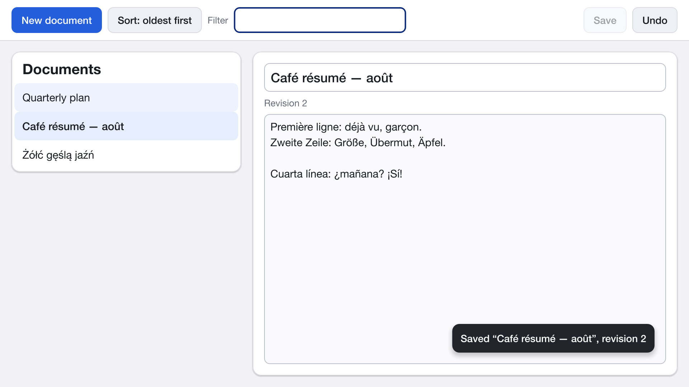
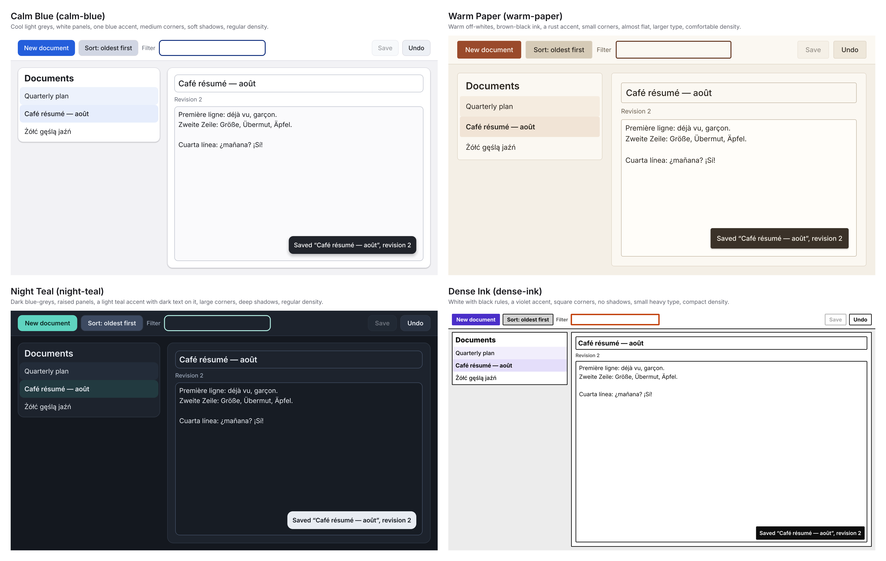

# The first three milestones, explained for designers

Written 2026-11-26. This merges the three milestone records ([S0](../records/milestones/S0.md), [S1](../records/milestones/S1.md), [S2](../records/milestones/S2.md)) into one document and rewrites them in plain language for a UX designer. The facts and numbers are the records'. The explanations and comparisons to design practice are added here. The records stay the source of truth, and they hold the file hashes and test names this version leaves out.

## The short version

- **S0 (done).** We checked that one MacBook can train the planned neural network. It can, with room to spare, so nothing was rented in the cloud.
- **S1 (done).** We built a small documents app and a way to draw its whole interface from a structured description, with no neural network involved yet. This hand-built version is the answer key the network will later be graded against.
- **S2 (started, not finished).** We wrote an original design system as tokens, kept it in sync with the code automatically, and drew the same screen in four different looks. We then built the first working path for training data: simulated sessions use the app, and every screen they reach is saved as a training example. The rest of S2 (more layouts, a pilot gallery, the full dataset) is still to come.

No neural network has been trained yet. Everything here is groundwork.

## What the project is trying to do

Most apps have their interface laid out by rules a person wrote. This project asks whether a trained neural network can do that layout and styling work instead.

The network does not paint pixels. It writes a **scene**: a structured list of every element on screen, with each one's position, size, colours, corner radius, shadow and state. Think of it as the layer tree of a Figma frame with all its properties filled in, saved as data. Ordinary, predictable code then draws that scene.

Two reasons for doing it this way, from the project's decision record:

1. **Text and click targets stay exact.** The words on screen and the actions behind buttons come from the app, never from the network. The network cannot misspell "Save" or make it do something else. It only decides how things look and where they go.
2. **Vector drawing is cheaper and steadier than generated pixels.** It holds still from frame to frame and stays sharp at any size.

The project names four ways of producing the interface. Two matter here:

- **A, Reference.** Hand-written layout rules write the scene. This is the teacher and the baseline. Everything drawn in S1 and S2 is A, Reference.
- **D, Neural Scene.** The trained network writes the scene. This is the goal, and it does not exist yet.

(B, Neural Raw and C, Neural Exact Text are older pixel-painting ideas, kept only as possible later comparisons.)

## Words you will need

| Project term | What it means | Closest design idea |
| --- | --- | --- |
| Scene | The full description of one screen: elements, geometry, style values, relationships, states | A Figma frame's layer tree with every property, as data |
| Bound element | An element that carries text or an action. The app supplies its text and action | A button, field, list row or label |
| Structural element | An element with no text and no action | A panel, divider or container |
| Binding | The command an element triggers | The "on click" behind a button |
| State | One of default, hover, pressed, focused, disabled | Component states |
| Visual preset | A named, complete set of style values | What most teams call a theme. The project avoids that word |
| Token | One named design value, such as a colour or a spacing step | Design tokens, Figma variables |
| Scene model | The neural network that will write scenes | No equivalent. It is the "designer" being trained |
| Runtime renderer | The code that draws a scene on screen | The rendering engine |
| Training renderer | A second renderer, built so the network can learn from pictures. Not built yet | No equivalent |
| Application kernel | The part of the app that holds the real data and runs commands | The back end, or app logic |
| Hit test | Asking "which element is under this point?" | Click and tap targets |
| Viewport unit | The scene's own unit of length. Drawn at 2 pixels per unit here | Points versus pixels, as in @2x export |

## S0: Can this Mac do the job?

*Covers issues #2 and #3.*

Before designing anything, the project had to know whether training a network on one laptop was realistic. If each practice round took too long or used too much memory, the plan would need cloud computers and a budget.

### Two tools were built

**`doctor`** is a health check. It lists the machine, the operating system and the exact version of every piece of software, then saves that as a record with a fingerprint called the environment id. Every later number points back to one of these records, so anyone can see exactly what setup produced it. The machine is an Apple M5 MacBook with 10 cores and 16 GiB of memory, running macOS 27.0.1.

**`measure step`** times one **training step**. A training step is one round of practice: the network makes a guess, the guess is scored, and the network is nudged to do better. Training is that round repeated many thousands of times, so the cost of one step decides how long everything takes.

### What was measured

The real network does not exist yet, so a stand-in of the same shape was timed. It was fed random numbers. That tells us what a step costs. It tells us nothing about whether a network can learn the task.

The test covered:

- **Five sizes.** Size is counted in parameters, the adjustable dials inside a network. The plan calls for 9 to 13 million. One size below that range, three inside and one above were tested.
- **Three batch sizes** (16, 64 and 256). Batch size is how many examples the network studies in one step.
- **Two processors.** The Mac's graphics chip (the Apple GPU) and its ordinary processor (the CPU).

That makes 30 cases. All 30 finished, on wall power with Low Power Mode off. Each case ran 10 warm-up steps and then 30 timed ones.

Typical (median) step time and peak memory at batch size 64:

| Size | Parameters | GPU step | GPU memory | CPU step | CPU memory | GPU is faster by |
| --- | --- | --- | --- | --- | --- | --- |
| d256-l8 | 6.37M | 87.4 ms | 1.57 GiB | 279.4 ms | 1.10 GiB | 3.2 times |
| d320-l8 | 9.93M | 115.1 ms | 1.50 GiB | 337.5 ms | 1.35 GiB | 2.9 times |
| **d384-l6** | **10.73M** | **113.3 ms** | **1.49 GiB** | 321.2 ms | 1.26 GiB | 2.8 times |
| d384-l7 | 12.51M | 132.0 ms | 1.49 GiB | 379.5 ms | 1.42 GiB | 2.9 times |
| d448-l7 | 17.00M | 167.4 ms | 1.62 GiB | 447.7 ms | 1.66 GiB | 2.7 times |

The size names read as width and depth: d384-l6 is 384 wide and 6 layers deep. The most memory any case used was 5.04 GiB (the largest size, batch 256, on the CPU). On the GPU the most was 4.61 GiB.

### What it showed

- **The GPU is about three times faster than the CPU** for this work.
- **The GPU handled everything.** Sometimes a graphics chip cannot do a certain kind of maths and quietly hands it to the slower CPU. The test ran with that safety net switched off, so any such case would have stopped the run. None did. This covers the stand-in only. The training renderer's maths gets the same check later, in S3.
- **A starting size was chosen: d384-l6**, with 10.73 million parameters. It is the tested size closest to the middle of the planned range.
- **Neither memory nor time is a limit on this Mac.** The chosen size peaks at 1.49 GiB against a budget of 8 GiB. One full pass over 20,000 examples (an epoch) takes 35 seconds against a budget of 300. No cloud run was proposed or started.

### How long training might take

These are projections, made by multiplying the measured step time (113.3 ms) by a number of steps. The pass counts are round numbers for scale. Nobody knows yet how many passes the network needs.

| Run | Examples | 10 passes | 100 passes | 1,000 passes |
| --- | --- | --- | --- | --- |
| Pilot | 200 | 5 s | 45 s | 7.6 min |
| Pilot | 500 | 9 s | 1.5 min | 15.1 min |
| Full | 5,000 | 89 s | 14.9 min | 2.5 h |
| Full | 20,000 | 5.9 min | 59.1 min | 9.8 h |

These cover only the simpler of the two planned training methods (structure only). They leave out things not yet measured: drawing pictures during training, loading real data, checking progress, and saving. The second method, which also learns from pictures, cannot be estimated until S3.

Why this matters to a designer: it sets the pace of iteration. A pilot experiment should come back in seconds or minutes, and a full run in about an hour to an overnight, all on one laptop.

### What went wrong, and what limits the numbers

- **The first attempt was thrown away.** Two work sessions started the measurement at once, on battery, in Low Power Mode, and their runs overlapped. Neither result was kept. The tool now refuses to start if another measurement is running, and it records the power state of every case.
- **The Mac was not idle.** Other apps were open and memory was tight, so three cases show a wide spread between their typical and slowest steps. The chosen size was steady, at 112.7 to 115.2 ms.
- **The CPU was not tuned.** It ran on the software's default of 4 threads on a 10-core machine, so the comparison is a first look and no more.
- **The stand-in is not the real network.** Its inputs are random and its scoring is simplified.
- **Memory figures include the tools themselves**, about 0.4 GiB before the first step.

### How it was checked

The tests run both tools for real on a version small enough to finish in seconds, then inspect the records they save. The rule that picks the starting size is tested on made-up results for cases that cannot be produced on demand, such as running out of memory. One check was done by hand: a kind of maths the GPU is known not to support was run on purpose, and all three ways of detecting it caught it.

## S1: The whole app, drawn without a neural network

*Covers issues #4 and #5.*

S1 built the app and the full path from "what the app knows" to "a picture on screen and a working click". It runs with no window open, which lets it be tested automatically and, later, produce thousands of training examples.

*Three documents, the second one opened, edited and saved. The first row is hovered and the filter field is focused. Drawn at 1920 by 1080 pixels.*

### The six parts

1. **Application kernel.** The app's memory and logic, for a simple documents app. It can create, open, rename, edit, save, list, sort, filter and undo. Everything lives in one small database file, including unsaved drafts, which document is open, the sort order, the filter, the notification and the undo history. Close it and reopen it, and it is in exactly the same state.
2. **Documents app adapter.** A content inventory of the screen. It lists every element in the document list, editor, toolbar and notification, each with its identity, role, exact text, action, state and relationships to other elements. It holds no positions and no styling. This is the part the neural network will never be allowed to change.
3. **Scene rules and validation.** The rulebook for a legal scene. A scene may hold at most 32 bound elements and 16 structural ones. A scene that breaks a rule is refused, with the reason. Nothing is quietly fixed.
4. **Reference layout.** The hand-written layout rules: one arrangement of the workspace, at any window size it fits.
5. **Runtime renderer.** The drawing code, built on Qt's painter, an established drawing library. It draws every style value: fill, text colour, border colour and width, corner radius, elevation (shadow), opacity, type size and type weight. Everything is drawn as vectors, so it is sharp at any scale.
6. **Scene session.** The front door that runs the other five in order and keeps count of what it saw: how many scenes, how many were invalid and why.

### Rules a designer will recognise

**States change looks and nothing else.** The five states are default, hover, pressed, focused and disabled. A state may change style values. It may never change an element's text, its action or its position. The app decides what is disabled (Save when nothing is unsaved, Undo when there is nothing to undo). Hover, pressed and focused apply only to elements that do something.

**The click target is the drawn shape.** Drawing and hit testing use the same outline, so a rounded button's clickable area is rounded too. The area never extends past what you see.

**Behaviour decisions made along the way** (all by Claude, in issue #5):

- **Undo is an exact reverse.** Undoing a save removes that revision and brings the draft back. Create, rename, edit and save can be undone. Open, sort and filter are view changes and cannot. There is no limit on how far back undo goes.
- **Rename takes effect at once.** Only the document body has a draft.
- **Drafts are kept per document**, so switching documents never loses unsaved text.
- **The notification has no dismiss.** Create, rename, save and undo show it. Open, edit, sort and filter clear it.
- **One sort button cycles through six orders.** Its label names the current order.
- **Sort and filter ignore capitals and most accents.** Typing "resume" finds "résumé". A few letters that Unicode cannot split from their accent, such as "Ż" and "ø", sort after "z".
- **"Last changed" is a counter, with no clock involved.** The same actions always produce the same state, so training data can be rebuilt exactly.
- **The editor body is one element**, however many lines it holds.
- **The open document's row knows it is shown in the editor.** That relationship is what the layout uses to tint the row.
- **The shadow has a written formula.** For an elevation of *e*, the element's own outline is shifted down by half of *e*, in black at 24% opacity, fading out over a band two elevations wide. It was written this way so the training renderer can later reproduce it exactly.
- **Out-of-range values can be snapped to the nearest allowed value, but only on request.** This is called projection. It is off by default, every snapped value is logged, and it is never applied to A, Reference.

### How it was checked

250 automated tests pass in 35 seconds. Highlights:

- **A simulated user.** 150 scripted actions were run the way a real host would: pick a point, find the element there, run its action. After every action the screen was drawn and every element was clicked at its centre. All 150 scenes were valid.
- **Undo.** 200 commands were run and then all undone, with the state compared at each step back.
- **Exact text.** Drawn text was compared with an independent drawing of the same string in French, German, Spanish and Polish, on one line and on four. They agreed to within 0.05% of the text's ink. A single wrong accent anywhere is caught.
- **Sharpness.** Shapes, shadows, text and click targets were tested at 1, 2 and 3.5 pixels per unit.
- **Click targets.** Around the corners of four elements, every pixel showing the element's fill hits it, and every pixel showing what is behind it does not.
- **Shadows** match the written formula at two elevations and three scales.
- **Bad scenes.** 34 kinds of invalid scene are each refused with the right reason. 24 refused commands change nothing.
- **Testing the tests.** The code was deliberately broken in 13 ways (a weaker shadow, square click targets, ignored opacity and so on). Each breakage made at least one test fail, and the code was restored afterwards.

### Known limits

- **Nothing scrolls.** With a document open and a notification showing, 21 list rows fill the 32-element limit. A 22nd is reported as an error. Nothing is clipped or dropped silently.
- **Text overflow is not checked.** Text wider than its box runs past the edge, and the scene still counts as valid. That check is planned for issue #8.
- **There is one layout.** The pictured state fits at 564 units wide and is reported as too small at 560, where the toolbar no longer fits. Nothing reflows or wraps.
- **The font was a system font** (Helvetica Neue) at this point. S2 replaces it.
- **An element is not required to sit inside its parent.** The layout keeps it there and a test confirms it, but the rulebook does not demand it.
- **The shadow is drawn in 32 fine steps.** It is a close approximation of a smooth fade.
- **The click-target test picks its elements.** A hovered row beside the open row was left out, because the soft edge of one fill blended to the same colour as the other and the test could not tell them apart. The renderer was not at fault.
- **Drawing speed and memory were not measured.**

## S2 so far: an original design system in four looks

*Covers issue #6, which was merged on 2026-11-26. Issue #7 has its own section below. S2 is not finished: issues #8 to #11 remain.*

S1 had its colours and sizes typed straight into the layout code. S2 replaces those with a real design source.

### What exists now

- **`DESIGN.md`**, the written design system, at the top of the repository. It follows Google Labs' DESIGN.md format (an early "alpha" version): tokens first, then prose sections for colour, typography, layout, elevation, shapes and components.
- **A generator configuration** (`configs/design/v1.json`) that says the same thing in the form the code reads. The layout now reads nothing else. The hard-coded values are gone.
- **`design check`**, a command that fails whenever the two files disagree. It solves the usual drift between a design file and the shipped code by making disagreement an error.
- **Four visual presets.**
- **`design draw`**, a command that draws one screen in every preset.
- **Inter** as the single typeface, stored in the repository.

The design covers semantic colours, typography, spacing, dimensions, borders, radii, elevation, density, the styling of each component and the five states.

### The four presets

| Preset | Character |
| --- | --- |
| `calm-blue` (default) | Cool light greys, white panels, one blue accent, medium corners, soft shadows, regular density |
| `warm-paper` | Warm off-whites, brown-black ink, a rust accent, small corners, almost flat, larger type, comfortable density |
| `night-teal` | Dark blue-greys, raised panels, a light teal accent with dark text on it, large corners, deep shadows, regular density |
| `dense-ink` | White with black rules, a violet accent, square corners, no shadows, small heavy type, compact density |

*The same screen in all four. This demonstration screen shows all five states at once: the first row hovered, the sort button pressed, the filter field focused, Save disabled, and everything else default.*

**A preset changes how things look and never what they say or do.** In every preset the elements, their text and their actions are identical, and every element can still be clicked at its centre.

### Accessibility

In every preset, all text that is not disabled has a contrast ratio of at least 4.5 to 1 against what is behind it. That is the WCAG AA level for normal-size text. It is checked with each of 8 elements hovered, pressed and focused in turn. To meet it, the hover blue in `calm-blue` was darkened from `#3D75EB` to `#2F68E0`.

Only text is held to a ratio. A field's border against its fill is not, and in `calm-blue` it is about 1.9 to 1, below the 3 to 1 that WCAG asks of interface component boundaries.

### Where it came from

Every value was written for this project, starting from the S1 values. Nothing was taken from Refero, from any other design collection, or from an existing product or brand. The only files downloaded were the Inter font and its licence. Inter is free to use and redistribute under the SIL Open Font License, and its source and attribution are recorded in [ASSETS.md](../ASSETS.md). Rob chose Inter. Every other decision below was made by Claude.

### Design-system decisions

- **One typeface for every preset.** The scene format has no value for font family yet. Presets differ in type size and weight.
- **Font weight is set as an exact number.** Asked for a weight by name, the drawing library picked the wrong cut of Inter at five of the nine weights. Inter's optical size is also pinned at one value (16). Left alone, macOS picks it from the drawn size, and the letter shapes would shift with it.
- **Overlapping letter outlines are filled correctly.** Parts of Inter's letters overlap, and the default drawing rule left holes where they did.
- **The top-level tokens are the default preset.** A tool that only understands the standard format sees one complete design. The other three presets sit beside it as full sets.
- **The format was extended where it fell short.** It has no place for dimensions, borders, elevation, density, opacity, states or presets, and it allows extra keys, so those were added. Motion and voice are listed as left out on purpose: a scene is one still frame, and every word on screen belongs to the app.
- **Each state is its own named component**, such as a button's hover version, which is how the format models states.
- **Components carry their own height and padding.** The layout reads them from the component.
- **Density means heights** (toolbar, control, row, title, notification). Widths are kept under dimensions.
- **Colours are six-digit hex** in both files.

### How it was checked

360 automated tests pass in 39 seconds, 110 of them new.

- **What is written is what is drawn.** For each preset, 60 values in the drawn scene (colours, type sizes and weights, heights, spacing, widths, borders, radii, elevations, disabled opacity) are compared with the values read straight out of `DESIGN.md`.
- **States in every preset.** 8 elements, 4 changed states, 4 presets: the style changes and nothing else does.
- **The sync check catches everything tried.** One value was changed in a copy of either file, 29 different ways, and each was reported by name.
- **The font.** The nine weights give nine different text widths, in rising order, and the font file matches its recorded fingerprint.
- **Testing the tests.** 11 deliberate breakages, each caught.

### Known limits

- **Google's own checker for the format was not run.** Running it means downloading and executing outside code, which was not done. The format is still alpha and may change.
- **Whether each preset looks intentional is judged by eye.** The tests check completeness and text contrast. Taste is for the pilot gallery (issue #9) and Rob's review of it (issue #10).
- **Roomier presets need bigger windows.** At 540 units high, the demonstration screen needs a width of at least 468 units in `dense-ink`, 570 in `calm-blue`, 590 in `night-teal` and 652 in `warm-paper`. At 960 wide, it needs a height of at least 168, 242, 242 and 282 in the same order. The data generator will have to pick window sizes with the preset in mind.
- **This Mac has its own copy of Inter installed.** The copy in the repository is the one drawn with. The font the drawing library selects is compared with it and refused if it differs, though two builds with identical header data would not be told apart.
- **The pictures show each non-default state once.** The tests, not the pictures, cover every element in every state.
- **The images depend on this Mac's text rendering.** A different version of macOS or of the drawing library may shift them slightly.
- **Drawing speed and memory were not measured.**

## S2, continued: the first training examples

*Covers issue #7.*

A network learns from examples. Each example here is a pair: what the network is told, and the scene it should have written. Issue #7 builds the machine that makes those pairs, and makes 82 of them as a first, tiny set.

### How an example is made

1. **A scripted session uses the app.** A script is a short list of actions, such as create, open, edit, save. The session carries each one out the way a person would: the pointer moves onto a button, presses it, and the app does what that button is bound to do. No shortcut puts the app into a state by hand, so every screen in the data is one a person could reach.
2. **Each step is three screens.** The element hovered, the element pressed (or focused, for a text field), and the app after the action. Each screen becomes one example. This is how hover, pressed and focused states get into the data.
3. **The layout rules write the correct scene** for that screen, in one visual preset and one window size. They always write the same scene for the same screen. Nothing about the answer is random.
4. **The scene is drawn** and the picture is saved beside it.

The titles and text the sessions type are made from a short list of invented words and lines with Latin accents. A session keeps one preset and one window size from start to finish, like one sitting at one app.

### What the network is told, and what it is not

For each element the network is told its role (button, list row, text field), what kind of action it has, its current state, how long its text is and how wide that text measures, and what it relates to (this row belongs to that list). It is also told the window size, the preset's token values, and five layout settings called the design condition: navigation position, panel arrangement, density, spacing and notification location.

It is not told the text itself. It is not shown the picture. It is never given the preset's name, the layout's name or anything about how the example was made. If any of that leaked in, the network could look the answer up instead of learning layout. A check refuses to save an example whose inputs contain the answer, and it was tried against ten different leaks, each caught.

### Layout families

A **layout family** is one arrangement of the screen, described by those five layout settings. There is one so far: toolbar across the top, list on the left, notification at the lower right. More arrive in issue #8. Later, whole families are held back from training to see how the network does on an arrangement it has never met.

### Traceable and repeatable

Every example records the session it came from, each action taken up to that screen, the random seed, the versions of the design and layout files, and the font. Run the generator again with the same settings and every file comes out identical, byte for byte. A second command, `data check`, proves that for a saved dataset by making it again and comparing.

The examples stay on this Mac. Git keeps one small file, the manifest, which lists a fingerprint for every example and picture.

### How it was checked

415 automated tests pass in 59 seconds, 55 of them new.

- **Every screen is reachable.** The test replays each example's actions in a fresh copy of the app and arrives at the same screen, 82 times.
- **Every answer is the layout rules' answer.** The test asks for each scene again, without the generator, and compares.
- **Every picture is the scene.** All 82 are drawn again and compared pixel for pixel.
- **State changes are clean.** Across the hover, pressed and focused versions of one screen, text, actions and positions stay the same. Only the pointed-at element's styling changes.
- **Testing the tests.** 18 deliberate breakages. 17 were caught. The 18th turned out to change nothing.

### Known limits

- **One layout family, and a tiny set.** 82 examples show that the path works. They are not a dataset to train on for real.
- **Text width is given at one font weight.** A button drawn in a heavier weight is slightly wider than that figure scaled, so the network cannot get such widths exactly right.
- **Text that overflows is still not caught.** That check comes with issue #8.
- **A screen that does not fit its window is rejected**, with the reason recorded. Nothing picks a better window size yet.
- **The files are tied to this Mac's text rendering**, as the pictures in S2 were.

## Where a designer's eye is needed

These come straight from the limits above. They are the open questions closest to design work:

1. **Do the four presets each read as intentional?** Nothing automated answers that.
2. **Field borders are faint** in `calm-blue`, at about 1.9 to 1.
3. **Long text has no rule yet.** Nothing truncates, wraps or clips.
4. **Long lists have no rule yet.** Nothing scrolls, and the screen tops out at 21 rows.
5. **Narrow windows have no rule yet.** One arrangement, with no reflow.
6. **The notification cannot be dismissed.** It stays until the next action replaces or clears it.

## What comes next

- **Issue #8.** More layout arrangements, variation in content and density, and checks that reject broken examples, text overflow among them.
- **Issue #12** can run alongside it: the first stage of the training renderer, covering rounded rectangles.
- **Issue #15** can also start: the first network, taught to reproduce the tiny set.
- **After that:** a pilot dataset with a review gallery (#9), and Rob's go or no-go on that gallery (#10).
