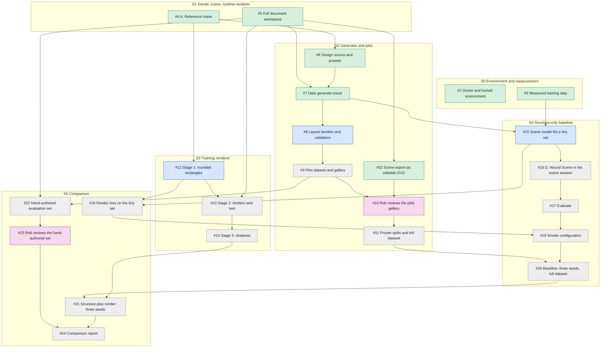

# Roadmap

Written 2026-11-26, from the spec ([issue #1](https://github.com/robdhyman/core-ultra-neural-engine/issues/1)), the state of issues #2 to #24 and #32 and their blocked-by links on GitHub, and the milestone records in `records/milestones/`. Terms are explained in [the designers' guide to S0 to S2](milestones-s0-s2-for-designers.md).

This roadmap gives order, not dates. The spec makes no time estimate that is not backed by a measurement, and the only one so far is the training step in S0.

## Where things stand

The spec has six milestones and 23 work issues, and one issue (#32) was added on 2026-11-26. It ends in one document: a report on whether teaching the network with pictures as well as with scene data makes it better on layouts it has never seen.

| Milestone | What it delivers | Issues | Status |
| --- | --- | --- | --- |
| S0, environment and measurement | Proof that this Mac can train the planned network | #2, #3 | **Done** |
| S1, kernel, scene and runtime renderer | The documents app, drawn from a scene with no network | #4, #5 | **Done** |
| S2, generator and pilot | Design system, training data, a pilot gallery, the full dataset | #6 to #11, #32 | **Started.** 2 of 7 done. #8 and #32 can start now |
| S3, training renderer | A second renderer the network can learn through | #12 to #14 | Not started. #12 can start now |
| S4, structure-only baseline | The first trained network, and the baseline result | #15 to #17, #19, #20 | Not started. #15 can start now |
| S5, comparison | The second training method, the hand-written test set, the report | #18, #21 to #24 | Not started |

Counted by issue: 6 done, 18 not started. No network has been trained yet.

## The map

Arrows mean "must finish before". Issues #17 and #19 serve both S4 and S5; they are drawn in S4.

Green is done. Blue can start now. Grey is waiting on something. Pink is a decision only Rob can make.

## Done

| Issue | What landed | Evidence |
| --- | --- | --- |
| #2 | `doctor`: a health check that records the machine and the exact software, with a fingerprint | PRs #25, #26 |
| #3 | `measure step`: one training step timed across 30 cases. The planned network fits this Mac with room to spare, and a starting size of 10.73 million parameters was chosen | PR #27, [S0 record](../records/milestones/S0.md) |
| #4 | The first working path from app state to a drawn screen and a click target, with no window | PR #28 |
| #5 | The whole documents app (list, editor, toolbar, notification, undo) drawn in A, Reference, with 250 tests | PR #29, [S1 record](../records/milestones/S1.md) |
| #6 | The original design system (`DESIGN.md`), its machine-readable twin, the check that keeps them in sync, four visual presets and the Inter font, with 360 tests | PR #30, merged 2026-11-26, [S2 record so far](../records/milestones/S2.md) |
| #7 | `data generate`: scripted sessions drive the app and every screen they reach is saved as a traceable training example. A tiny dataset of 82 examples, a check that nothing the network is given contains the answer, and `data check`, with 415 tests | [S2 record so far](../records/milestones/S2.md) |
| #32 | `scene export`: any scene written as an SVG of separate named objects, with text as text, made to be opened in a design tool. No design tool has been tried yet. `scene compare` measures the SVG against the runtime renderer: on the tiny dataset the mean difference is 0.43 levels of 255, nearly all of it text. Eight SVGs were handed to Rob with a note for #10 that lists what the scene schema cannot express | [S2 record so far](../records/milestones/S2.md), [hand-off note](../.scratch/scene-export/handoff-scene-as-svg.md) |

## Next

In the order they unlock:

1. **#8, layout families and validators.** Ready now. More than one arrangement of the screen, with checks that reject broken samples. This is also where text fit gets checked.
2. **#12, training renderer stage 1.** Ready now. It depends only on #4. The first piece of the renderer the network learns through: rounded rectangles, with proof that its learning signal is correct.
3. **#15, the scene model fits a tiny set.** Ready now. The first network, taught to reproduce the tiny dataset that #7 left.
4. **#9, pilot dataset and gallery.** 200 to 500 examples across every preset and layout family, in a gallery made for review.
5. **#32, scene export as editable SVG.** Done; see the table above. It trained nothing and changed no schema. It exists so that Rob sees the scene as an editable vector document before #10, and so that the gaps in the scene schema are known before #11 freezes the dataset.
6. **#10, Rob's go.** Nothing is scaled up until Rob has looked at the gallery and said go. He also opens the exported SVGs here and revisits the questions under "After this spec".

The spec lets S3 proceed alongside S2, so #8, #12, #15 and #32 can run side by side.

## Later

- **S2 closes with #11.** After Rob's go, the rules for splitting data into training and test sets are frozen, and the full dataset is generated.
- **S3 closes with #14.** Borders and text (#13), then shadows (#14), each added alone and checked before the next.
- **S4, the first trained network.** A small network learns a tiny set (#15), runs inside the app's drawing path as D, Neural Scene (#16), gets its measuring tools (#17), and the whole pipeline is made to run in minutes as a smoke test (#19). Then the baseline is trained three times on the full dataset (#20).
- **S5, the comparison.** The picture-based training method is proven on the tiny set (#18) and trained three times on the full dataset (#21). About 24 hand-written scenes test the network outside the generator's own style (#22), and Rob reviews them (#23). The comparison report (#24) ends the spec.

## The two points that wait on Rob

| Issue | Decision | What it holds up |
| --- | --- | --- |
| #10 | Do the pilot examples look coherent enough to scale? Seen as SVG, is the scene the editable document Rob expected? | #11 (full dataset), and through it every full training run |
| #23 | Is the hand-authored evaluation set acceptable? | #24 (the comparison report) |

## The longest chains

With #7 done, two chains of seven issues remain. Both end at #24:

- **Data:** #8 → #9 → #10 → #11 → #20 → #21 → #24
- **Model:** #15 → #16 → #17 → #19 → #20 → #21 → #24

They meet at #20, the first full training run, which needs both the full dataset (#11) and the smoke test (#19). The second full run (#21) also needs the finished training renderer (#14).

## After this spec

The spec stops at the comparison report. Left for the next spec: the interactive native app in a real window. Outside this spec altogether: networks that paint pixels (B, Neural Raw and C, Neural Exact Text), any recording of real use, platforms other than macOS 27 on Apple silicon, and any claim about design taste, usability, accessibility or production readiness.

### Questions held for later

Recorded 2026-11-26. These are questions, not milestones: none has a ticket, and none is to be designed toward until Rob opens it. Rob chose to finish the report first and test the editor idea cheaply through #32.

| Question | What would open it | Known cost |
| --- | --- | --- |
| Should the scene become a full design document (free paths, groups, image assets, constraints)? | #32 shows, at #10, that the exported scene is too thin to edit usefully | A new scene schema version. The dataset frozen at #11 and the training renderer from S3 would both have to be redone for it |
| Is a scene with real bindings the base of an editor that joins a design canvas with working interactions? | Rob asks for it after #10 or after the first network runs at #16 | A throwaway prototype on its own branch (move an element, its bound action still works). It needs no network, and it needs the real window the next spec owns |
| How does D, Neural Scene compare with a language model that writes HTML, CSS and JavaScript for the same application states? | D, Neural Scene runs (#16) and `evaluate` exists (#17) | A browser to measure in, kept outside the product path (ADR 0002), and API spend |
| Can a rendered page be turned into a scene (browser to design tool)? | Only as a new spec | The model here runs the other way, from application state to a scene. Design tools already ship the deterministic part of this conversion |

## Known limits that later issues must deal with

These come from the S1 and S2 records and are not yet assigned beyond what is noted:

- **Nothing scrolls**, and a screen holds at most 32 bound elements (21 list rows). The generator must stay inside that or the limit must rise.
- **Text fit is unchecked** until #8.
- **Roomier presets need larger windows.** The tiny dataset uses two sizes that fit every preset. A screen that does not fit is rejected with its reason, never written. Choosing sizes with the preset in mind is #8's.
- **One layout family so far**, and one value for each design factor. #8 adds the rest.
- **The network is told a text's width at one font weight.** Text drawn at another weight is not exactly that width scaled, so a small error in such widths is built in.
- **Whether each preset looks intentional** is judged at #9 and #10.
- **The cost of the picture-based training step is unknown** until #18 measures it.
