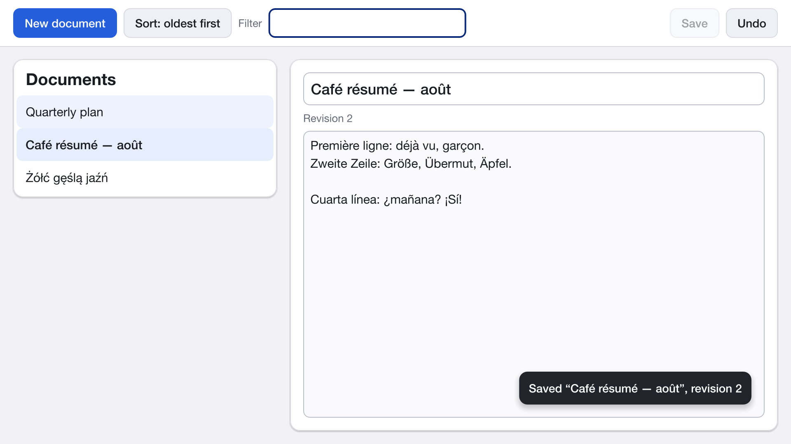

# S1 milestone record: kernel, scene and runtime renderer

Written 2026-11-25. Covers issues #4 (the A, Reference tracer) and #5 (the full document workspace in A, Reference).

Machine: Apple M5 (Mac17,2), 10 cores, 16 GiB, macOS 27.0.1, Python 3.12.14, PySide6-Essentials 6.12.0.
Environment id `sha256:a2fc43e720537c652288d14dd218a43dba45b43ff0474e9441bf9f6062d650c5`, as `uv run core-ultra doctor` printed it on this date. It differs from the id in the S0 records because the Qt dependency was added in issue 4.

## What runs

Application state to a drawn interface and a hit test, without a window, for every state the documents app can reach.

- **Application kernel.** Create, open, rename, edit, save, list, sort, filter and undo, with validation and revisions, in one SQLite file. Unsaved drafts, the open document, the sort order, the filter, the notification and the undo log are stored too, so a reopened store reports the same state.
- **Documents app adapter.** The whole workspace as bound elements: the document list, the editor, the toolbar and the notification, each element with its identity, role, exact text, binding, state and relationships.
- **Scene schema and validation.** Unchanged in shape since issue 4: schema version 1, limits of 32 bound and 16 structural elements.
- **Reference layout.** One arrangement of the workspace in one set of plain style values, at any viewport size it fits.
- **Runtime renderer.** Qt's painter, off screen, confirmed in `docs/adr/0002-qt-painter-is-the-runtime-renderer.md`. It now draws every style value, elevation included, and text on several lines.
- **Scene session.** Counts candidate scenes, invalid scenes by reason and projected values, and reports them.

The same state the tests start from, drawn at two pixels per viewport unit (1920 by 1080), with the first row hovered and the filter field focused:

`S1-workspace.png`, SHA-256 `2b9cc9903dfaf877b1abe86e759cd30a004d6f76192c992be43c2e62c2112626`. It was written by `runtime_renderer.write_png` from a frame of three documents, the second opened, edited and saved.

## Issue 5, criterion by criterion

| Criterion | Where it is shown |
| --- | --- |
| Kernel commands, validation and revisions in SQLite; state survives closing and reopening | `tests/test_kernel.py`: each command, 24 refused commands that change nothing, a reopened store compared field for field and then undone back to its start |
| Adapter describes list, editor, toolbar and notification with semantic relationships | `test_state_is_described_as_bound_elements…`, `test_every_relationship_names…`, `test_identities_are_stable…` |
| Five states change style and never text or binding | `test_a_state_changes_style_and_never_text_or_binding`: 8 elements by 5 states; box and every other element unchanged |
| Renderer draws fill, text colour, border colour and width, corner radius, elevation, opacity, type size and weight | `test_fill_border_and_corner_radius_are_drawn`, `test_opacity_blends…`, `test_elevation_is_drawn_as_the_documented_shadow…`, `test_text_colour_type_size_and_type_weight_are_drawn` |
| One scene at several window sizes without blur; hit targets match drawn shapes at each | The shape, shadow, text and hit-target tests each run at 1, 2 and 3.5 pixels per viewport unit |
| Latin text with accents drawn exactly | `test_the_drawn_text_is_exactly_the_applications_text`: French, German, Spanish and Polish, on one line and on four |
| Limits of 32 bound and 16 structural; overflow reported | `test_more_bound_elements_than_the_limit…`, `test_the_structural_limit_is_sixteen`, and the 17th structural element among the invalid cases |
| Invalid scenes counted and reported; projections logged and counted apart; nothing repaired silently | `test_invalid_scenes_are_counted_and_reported_by_reason`, the four projection tests |
| End-of-milestone record | This file |

## What was tested

`uv run pytest`: 250 tests pass in 35 s (124 before issue 5). 44 are kernel tests and 147 are scene session tests; the rest are the S0 command tests, unchanged.

- **Every reachable state.** A seeded session of 150 actions is driven the way a host would drive it: a point is hit tested and the binding of the element found there is run by the kernel. All eight commands that have a binding occur. After each action the state is drawn, and every bound element is hit at its own centre. The session's report ends at 150 scenes, 150 valid.
- **Undo.** 200 seeded commands, then every one undone: after each undo the documents, drafts and revisions equal the snapshot taken before the command it reversed.
- **Exact text.** Each element's pixels are compared with Qt's own text-to-path (`QPainterPath.addText`) drawing the same string by the renderer's stated placement rules. They agree to within 0.05% of the text's ink; the largest difference seen was 0.011%, on one row at scale 2, and most elements differ by nothing. One wrong accent anywhere, including one in the body's four lines, exceeds twice that tolerance.
- **Shadow.** Every pixel row from an elevated panel's lower edge to two elevations below it is within 4 levels of 255 of the documented formula, at elevations 4 and 12 and three scales.
- **Hit targets.** Around each corner of four filled elements (a filled button, a bordered button, the open document's row, the notification lying over the editor), every pixel showing the element's fill hits it and every pixel showing what is behind does not.
- **Validation.** 34 kinds of invalid scene are each refused with the expected code.

Checked by hand, not by a test: 13 deliberate breakages of the code (a weaker shadow, a shadow not moved down, a different line pitch, a shifted text inset, square hit outlines, opacity ignored, undo not consuming its log entry, a draft equal to the body kept as a draft, descending sort ignored, style values not projected, projection modifying the scene it was given, application-disabled state not applied, disabled style not applied). Each made at least one test fail. The code was restored after each.

## Decisions made by Claude in issue 5

- **Undo is the exact inverse.** Undoing a save or a rename removes the revision it committed and, for a save, brings the draft back. Create, rename, edit and save are undone; open, sort and filter are view changes and are not. The undo log has no limit.
- **Rename commits at once** as the next revision; only the body has a draft.
- **No wall clock in the kernel.** "Last changed" is a counter that rises with each committed change, so identical commands give identical state and later dataset records can be regenerated exactly.
- **Sort and filter fold case and separable accents** ("resume" finds "résumé"). A letter Unicode cannot take the accent from, such as "Ż" or "ø", sorts after "z".
- **Drafts are kept per document**, so opening another document never loses or refuses unsaved text.
- **The notification is the kernel's.** Create, rename, save and undo set it; open, edit, sort and filter clear it. No command dismisses it.
- **One sort button** steps through six orders; its text names the current order and its binding names the next.
- **Relationships** name another bound element or one of the four parts of the workspace (`workspace.toolbar`, `workspace.list`, `workspace.editor`, `workspace.notification`). The open document's row is related to the editor body (`shown_in`), which is what the reference layout tints.
- **`disabled` comes from the application** (Save with nothing unsaved, Undo with nothing to undo). Interaction states are accepted only for elements with a binding.
- **The editor body is one bound element** with one line per line feed, not one element per line.
- **Shadow model** for elevation e: the element's outline moved down by e / 2, black at alpha 0.24, a smoothstep from full at e inside the edge to nothing at e outside, drawn as 32 nested outlines. Chosen so the training renderer can match it from a distance function.
- **Projection** is off unless asked for, never applied to A, Reference, moves a box that lies partly outside the viewport without resizing it, and leaves alone any value with no nearest allowed value. Whether D, Neural Scene asks for it is for issue 16.
- **A store at schema version 1 is upgraded** when opened; any other unknown version is refused.

## What failed, and what limits this

- **Nothing scrolls.** With a document open and a notification showing, 21 rows reach the limit of 32 bound elements; a 22nd is reported as `limit_exceeded`. Three rows already fail to fit a viewport 230 units tall. Both are reported, never clipped, but the generator will have to keep its sessions inside these limits or the limits will have to rise.
- **Text fit is not checked.** Text wider than its box is drawn across the box's edge and the scene is still valid. Issue 8's validators are where text fit is checked.
- **One arrangement, one set of style values.** The state pictured above is valid at 564 units wide and reported as `outside_viewport` at 560, where the toolbar no longer fits.
- **The font is a system font.** Helvetica Neue is read from macOS and never redistributed. It has no face at weight 600 or 800; the font system substitutes its nearest. Fonts with recorded provenance arrive with the visual presets.
- **The hit-target test chooses its elements.** A hovered row next to the open document's row was dropped from it: the anti-aliased edge of the open row's fill over white is the same colour as the hover fill, so the test could not tell the two apart by colour. The renderer was not at fault. The test now uses fills that no blend of a neighbour's edge can pass for.
- **A bound element's parent is not checked against its box.** The reference layout keeps each element inside the structural element it belongs to, and a test asserts it, but scene validation does not require it.
- **The shadow is an approximation in steps.** 32 outlines give steps of under 2 levels of 255; the test's tolerance of 4 levels covers the steps and pixel averaging.
- **Not measured:** drawing time and memory. Nothing in this milestone asked for a measurement, and none is reported.

## Next executable step

Issue #6: the original DESIGN.md, the generator configuration and three to five visual presets. It replaces the constants at the top of `src/core_ultra/reference_layout.py` and draws this record's state in every preset. Issue #12, stage 1 of the training renderer, can start alongside it; the shapes and the shadow it must agree with are described at the top of `src/core_ultra/runtime_renderer.py`.
