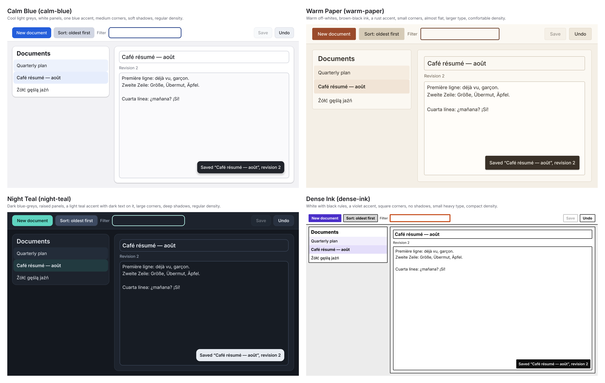

# S2 milestone record: generator and pilot

S2 is not finished. This record is added to as its issues land. So far it covers issue #6, the design source.

## Issue 6: original DESIGN.md, generator configuration and visual presets

Written 2026-11-25.

Machine: Apple M5 (Mac17,2), 10 cores, 16 GiB, macOS 27.0.1, Python 3.12.14, PySide6-Essentials 6.12.0, PyYAML 6.0.4.
Environment id `sha256:6b5d299af418a80202b1eafa91dbc1789f7df3cf640eddea7286f9138290ce58`, as `uv run core-ultra doctor` printed it on this date. It differs from the id in the S1 record because PyYAML was added.

### What runs

- **DESIGN.md**, at the repository root, in the Google Labs DESIGN.md format, version alpha. YAML tokens, then prose in the format's section order.
- **The generator configuration**, `configs/design/v1.json`, which says the same in the generator's vocabulary. The reference layout reads nothing else: the style constants that stood at the top of `reference_layout.py` are gone.
- **`core-ultra design check`**, which fails when the two disagree.
- **Four visual presets**: `calm-blue` (the default), `warm-paper`, `night-teal` and `dense-ink`. `Conditioning(960, 540, visual_preset="warm-paper")` draws a state in one of them.
- **`core-ultra design draw`**, which draws one application state in A, Reference in every preset.
- **Inter**, in the repository, as the one font all text is drawn in.

The same application state in every preset, at two pixels per viewport unit:

The state: three documents, the second opened, edited and saved; the first row hovered, the sort button pressed, the filter field focused, and Save disabled by the application, so all five states are in each picture. `records/design/v1/` holds one image per preset and `manifest.json`, which gives the SHA-256 of every image, of every scene, of the configuration and of the font.

### Criterion by criterion

| Criterion | Where it is shown |
| --- | --- |
| One original DESIGN.md covering semantic colours, typography, spacing, dimensions, borders, radii, elevation, density, element styling and the supported states | `DESIGN.md`. Each of those is a token group or the `components` and `states` keys, and has its prose section. `test_a_design_md_that_breaks_the_format_is_reported` holds it to the format's rules (16 ways of breaking them). |
| A machine-readable generator configuration covering the same ground; an automated check fails when the two disagree | `configs/design/v1.json`; `core-ultra design check`. `test_one_changed_value_in_either_file_is_a_named_disagreement` changes one thing in a copy of either file, 29 ways across all nine token groups, the components, the states and the font, and each is named. `test_the_committed_design_md_and_generator_configuration_agree` runs the check on the committed files in every test run. |
| Three to five visual presets, each a coherent set of colour, type, spacing, radius, elevation and density values, named descriptively | Four. `test_there_are_three_to_five_presets_each_a_complete_set_of_the_same_tokens`, `test_presets_differ_in_colour_type_spacing_radius_elevation_and_density`, and the contrast test below. |
| The same application state drawn in A, Reference in every preset, as images a person can compare | `records/design/v1/`. `test_the_committed_images_are_the_demonstration_state_in_every_preset` redraws the state and compares each scene with the hash in the manifest. |
| Fonts and assets are original or licensed for this use, with source and attribution recorded | `ASSETS.md`; the `font` block of the configuration. `test_the_font_drawn_is_the_bundled_file_with_its_source_and_licence_recorded`, `test_no_repository_file_other_than_the_recorded_assets_is_a_font_or_an_image_asset`. |
| No Refero export, screenshot or extracted token, and no external design corpus, enters the presets or the repository | Every value was written in this session from the S1 constants and from scratch. Nothing was fetched from Refero or from any design collection. The only files fetched were the Inter font and its licence. This is a statement about how the work was done; no test can show it. |

### What was tested

`uv run pytest`: 360 tests pass in 39 s (250 before this issue). 110 are the new design tests.

- **DESIGN.md is what is drawn.** For each preset, the test reads DESIGN.md's YAML itself and compares 60 values in the drawn scene with it: 18 colours, 8 type sizes and weights, the heights, the spacing, the widths, the borders, the radii, the elevations and the disabled opacity. It then reads two pixels of the image. It does not go through the code that loads the configuration.
- **A preset never changes meaning.** In every preset the bound elements are identical, every bound element is hit at its own centre, and the four images are four different images.
- **States, in every preset.** 8 elements by 4 changed states by 4 presets: the style changes, the box, the text, the binding and every other element do not.
- **Contrast.** In every preset, with each of 8 elements in turn hovered, pressed and focused, every piece of text that is not disabled has a contrast ratio of at least 4.5 to 1 against what is drawn behind it, computed from the scene.
- **The font.** The nine weights from 100 to 900 give nine different widths in rising order. The file's hash, the licence's hash and every fact in `ASSETS.md` are compared with the configuration.
- **Exact text**, from S1, now judges Inter: the judge sets the same two font axes and fills overlapping contours.

Checked by hand, not by a test: 11 deliberate breakages of the code (the check ignoring one token group, states ignored, section order unchecked, a token's kind unchecked, the preset ignored, one spacing value left as a constant, the default text colour left as a constant, glyph overlaps left as holes, the optical size not pinned, weight chosen by name, the demonstration state without its states). Each made at least one test fail. The code was restored after each.

### Decisions

Made by Rob on 2026-11-25: the font is Inter, downloaded into the repository.

Made by Claude:

- **One font family for every preset.** The scene schema has no value for a font family, and adding one is a schema change no issue has asked for. Presets differ in type size and weight.
- **Optical size pinned at 16**, weight set as an axis value. Asked for a weight by name, Qt 6.12 picked the wrong instance of Inter at five of the nine weights on this Mac. With no axis set, macOS chooses the optical size from the pixel size. A request equal to the font's defaults (weight 400, optical size 14) is dropped, so 14 could not be pinned at weight 400; 16 sits in the middle of the type sizes the presets use.
- **Glyph outlines are filled by winding.** The contours of Inter's glyphs overlap, and the default fill rule drew each overlap as a hole.
- **The top-level tokens of DESIGN.md are the default preset**; the other three are complete sets under `presets`. A tool that reads only the format's own keys sees one complete design.
- **Extension keys in DESIGN.md.** The format has no token group for dimensions, borders, elevation, density, opacity, states or presets, and no component property for a border, an elevation or an opacity. It allows extra keys. Motion and Voice are listed under the format's `omitted` key with the reason.
- **States are separate components** named `<component>-<state>`, as the format has them. Focused and disabled are written out on each of the seven components that take a state.
- **Components carry their own height and padding** as well as style values, and the layout reads them from the component.
- **Density is the group of heights** (toolbar, control, row, title, notification). `dimensions` holds widths.
- **The configuration is found from the repository root**, not the working directory, because drawing A, Reference needs it from anywhere.
- **Colours are #RRGGBB in both files.** The S1 constants were rounded to the nearest such colour for `calm-blue`, and its hover blue was darkened from `#3D75EB` to `#2F68E0` to reach 4.5 to 1 under white text.
- **PyYAML** was added to read DESIGN.md.
- **A demonstration state with all five states** replaces the S1 picture's state for the preset images.

### What failed, and what limits this

- **Google's linter was not run.** `@google/design.md` is an npm package; running it means downloading and executing it, which this session did not do. The format rules were taken from the published spec and README on 2026-11-25. Expect its `token-like-ignored` warning for the extension groups and its unknown-property warning for `borderColor`, `borderWidth`, `elevation` and `opacity`. The format is alpha and may change.
- **Coherence is judged by eye and by one rule.** The tests hold each preset to complete tokens and to text contrast. Whether a preset looks intentional is for the pilot gallery in issue #9 and Rob's look at it in issue #10.
- **Only text contrast is held to a ratio.** A field's border against its fill is not; `calm-blue`'s is about 1.9 to 1.
- **Larger presets need a larger viewport.** The demonstration state is valid from 570 units wide in `calm-blue`, 590 in `night-teal`, 652 in `warm-paper` and 468 in `dense-ink`, at 540 high; and from 242, 242, 282 and 168 units high at 960 wide. The generator will have to sample viewports with the preset in mind.
- **Another Inter on the machine.** This Mac has Inter installed. The face Qt selects is compared with the bundled file by its `head` table and refused if it differs; here they were the same. Two different builds with an identical `head` table would not be told apart.
- **The images are tied to this machine's text rendering.** The test compares scene hashes, which depend on text measurement, and the PNG hashes in the manifest depend on Qt's rasteriser. A different Qt or macOS version may change both.
- **Pressed, in the pictures, is one button.** The other states are each shown once too. The state tests, not the pictures, cover every element.
- **Not measured:** drawing time and memory.

### Next executable step

Issue #7, the `data generate` tracer: scripted sessions drive the kernel, and each state is written as a dataset record with its model inputs, its true scene in a visual preset and its reference image. `design.load().presets` is the list to sample from. Issue #12, stage 1 of the training renderer, can still start alongside it.
